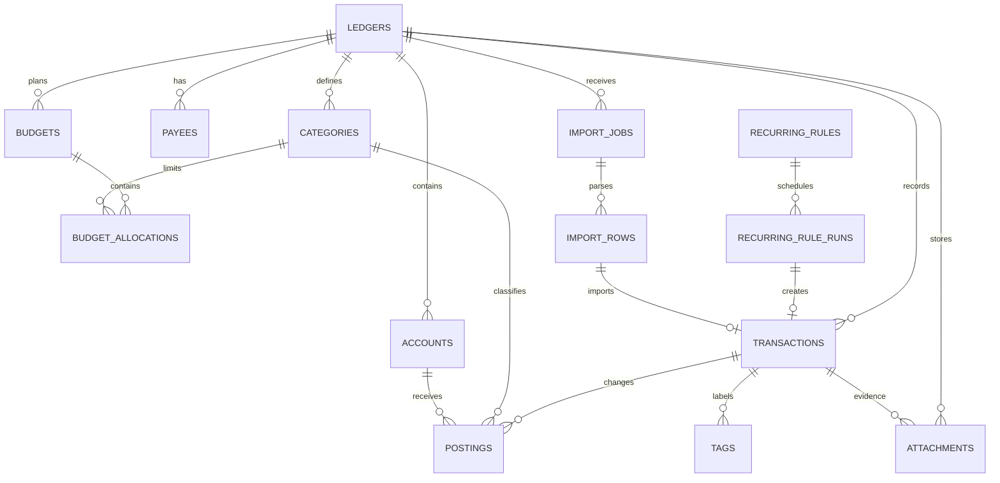

# EasySpends 数据库表结构与本地存储方案

> 版本：v1.0 设计稿  ·  数据截点：2026-08-22  ·  目标平台：macOS Electron

## 1. 设计目标

EasySpends 的数据层需要同时满足三类需求：第一类是日常记账的低门槛，包括收入、支出、账户、分类、转账、周期交易和预算；第二类是专业财务能力，包括多币种、复式分录、净资产、导入导出和可审计的报表；第三类是本地隐私能力，包括离线运行、可控同步、加密备份、附件隔离和故障恢复。设计主要借鉴 [ezBookkeeping][5] 的轻量、自托管、多账户、多币种、导入导出和 PWA 思路，同时吸收 Actual 的本地优先和 Firefly III 的复式记账与规则模型。

> **核心决定：** EasySpends 第一阶段采用“Electron 主进程独占 SQLite + React 渲染进程只通过白名单 IPC 访问”的架构。数据库默认只保存在当前 Mac，不把业务数据放入浏览器 localStorage，也不要求联网才能记账。

当前 MVP 使用三个表：`accounts`、`categories`、`transactions`，金额以分存储，并在 Electron `app.getPath('userData')` 下初始化数据库。目标版本保留这些概念，但将交易升级为“业务事件 + 复式分录”，从而可以自然表达转账、退款、拆分、多币种和预算，而不需要在后期重做核心模型。

## 2. 总体架构



系统分为四层。**领域层**保存账本、账户、分类、交易和预算；**输入层**处理手工录入、周期规则、CSV/OFX/QIF 导入、OCR 或语音候选；**证据层**保存收据附件、导入原文、哈希和审计事件；**同步层**只保存应用级变更日志和同步游标，不直接复制正在使用的 SQLite 文件。

| 层次 | 主要内容 | 是否允许直接被渲染进程访问 |
|---|---|---:|
| 领域数据 | `ledgers`、`accounts`、`categories`、`transactions`、`postings`、`budgets` | 否；只通过主进程查询服务 |
| 用户输入 | 手工录入、周期交易、导入预览、AI/OCR 候选 | 否；必须经过主进程校验与事务提交 |
| 文件证据 | 收据、发票、导入文件、备份 | 否；通过受控文件选择器和主进程读写 |
| 凭证与密钥 | 同步 Token、数据库密钥封装材料、Provider 配置 | 否；使用 macOS Keychain/safeStorage |
| UI 状态 | 当前筛选、表单草稿、窗口状态 | 可以；仅限非敏感临时状态 |

## 3. 关键数据约定

### 3.1 ID、金额和时间

所有目标表使用应用层生成的 UUID 或 ULID 字符串作为主键，不使用 SQLite 自增整数作为跨设备同步 ID。当前 MVP 的整数 ID 在迁移时保留映射表，不直接复用为最终 ID。UUID/ULID 可以避免未来导入或同步时因不同设备自增序列冲突。

金额统一使用整数最小货币单位保存，例如人民币 12.34 元保存为 `1234`。金额字段不使用 SQLite `REAL`，汇率使用正整数分子和分母保存；计算、四舍五入和展示格式由领域服务负责。对于金额较大的投资或跨币种场景，应用应检查是否超过 JavaScript 安全整数，并在需要时改用 bigint 字符串或 Decimal 库。

交易记录同时区分**记账日期**和**实际时间**。`occurred_date` 使用 `YYYY-MM-DD`，用于月度预算和报表；`occurred_at` 可以为空，用于保存用户明确提供的时间。账本保存 `timezone`，所有日报、月报、预算周期均以账本时区计算，数据库创建和修改时间保存为 UTC ISO-8601 文本。这样可以避免用户在旅行或夏令时切换时出现跨日、跨月错账。

### 3.2 复式分录符号

`postings.amount_minor` 使用有符号金额。对于个人记账，建议采用以下规则：资产账户流入为正、流出为负；支出分类为正；收入分类为负；转账的转出账户为负、转入账户为正。同一笔交易的 `base_amount_minor` 总和必须为 0。

| 业务事件 | 分录示例 | 结果 |
|---|---|---|
| 餐饮支出 35 元 | 银行账户 `-3500`；餐饮分类 `+3500` | 资产减少，支出增加 |
| 工资收入 15,000 元 | 银行账户 `+1500000`；工资分类 `-1500000` | 资产增加，收入增加 |
| 现金转银行卡 500 元 | 现金账户 `-50000`；银行卡 `+50000` | 总资产不变，仅账户间移动 |
| 退款 20 元 | 银行账户 `+2000`；原支出分类 `-2000` | 资产增加，支出抵减 |
| 午餐拆分 60 元 | 银行账户 `-6000`；餐饮 `+4500`；娱乐 `+1500` | 一笔支付对应多个分类 |

SQLite 的普通 `CHECK` 约束不能单独验证“同一交易多行分录之和为 0”，因此该约束必须在主进程的领域服务中、同一个写事务内验证。写入前还要校验：交易至少有两条分录；分录只能指向一个账户或一个分类；支出和收入的分类类型必须匹配；转账不能包含收入/支出分类；拆分合计必须等于交易总额。

## 4. 表结构设计

### 4.1 基础配置与账本

| 表 | 作用 | 关键字段 |
|---|---|---|
| `schema_migrations` | 记录已应用迁移版本和校验值 | `version`、`name`、`checksum`、`applied_at` |
| `app_settings` | 保存非秘密的应用设置 | `key`、`value_json`、`updated_at` |
| `ledgers` | 支持个人账本、家庭账本或未来多账本 | `name`、`base_currency_code`、`timezone`、`is_default` |
| `currencies` | 货币元数据和小数位规则 | `code`、`symbol`、`decimal_digits`、`is_active` |
| `exchange_rates` | 保存指定日期和来源的汇率 | `base_currency_code`、`quote_currency_code`、分子/分母、`effective_date`、`source` |

`app_settings` 只保存主题、默认账户、默认分类、最近筛选等非秘密配置。同步 Token、AI API Key、数据库加密密钥和密码不进入该表。`ledgers` 现在只创建一个默认账本，但表结构预留多账本能力，以支持个人、家庭和工作账本隔离。

### 4.2 账户与分类

| 表 | 作用 | 关键字段 |
|---|---|---|
| `accounts` | 银行卡、现金、电子钱包、信用卡、投资、贷款等真实或虚拟账户 | `account_type`、`currency_code`、`parent_id`、`opening_balance`、归属账本 |
| `categories` | 收入/支出分类树 | `category_type`、`parent_id`、`color`、`icon`、`system_key` |
| `payees` | 商户、付款方和默认分类 | `name`、`normalized_name`、`default_category_id` |
| `tags` | 灵活的项目、场景或家庭成员标签 | `name`、`color` |
| `transaction_tags` | 交易和标签的多对多关联 | `transaction_id`、`tag_id` |

账户和分类都支持二级或多级树结构，但 UI 第一版可以只展示两级。`is_archived` 用于隐藏旧账户和分类，不建议直接删除已经被交易引用的对象。账户删除默认使用归档；若确实需要删除，应由数据库外键和领域服务共同阻止破坏历史数据。

账户余额不作为唯一事实存储，而是由期初余额、账户分录和必要的调整分录计算得到。可以使用缓存表或物化汇总加速，但必须能够从 `postings` 重算，以保证账本可修复。

### 4.3 交易、分录和凭证

| 表 | 作用 | 关键字段 |
|---|---|---|
| `transactions` | 一次业务事件的主记录 | `transaction_type`、`occurred_date`、`total_minor`、`currency_code`、`source`、`status`、`revision` |
| `postings` | 交易对账户或收入/支出分类的实际影响 | `account_id` 或 `category_id`、`amount_minor`、`base_amount_minor`、汇率分子/分母 |
| `attachments` | 收据、发票、截图和其他原始凭证的元数据 | `sha256`、`relative_path`、`mime_type`、`size_bytes`、`encryption_version` |
| `audit_events` | 重要变更和导入/同步行为审计 | `actor_type`、`action`、`entity_type`、`entity_id`、`metadata_json` |

`transactions` 是面向产品的业务事件，`postings` 是面向财务一致性的事实记录。用户在 UI 中看到的是一笔交易，报表和余额从分录中计算。`source` 区分手工、导入、OCR、语音、周期规则、同步和迁移；AI/OCR 结果必须先进入草稿或导入预览，用户确认后才生成 `posted` 交易。

建议的状态流转为：`draft → posted → voided`。已入账记录不做物理删除，用户请求删除时写入 `deleted_at` 或生成冲销交易，并在 `audit_events` 中记录原因。这样可以避免报表因删除历史数据而突然改变，也方便恢复和审计。

### 4.4 周期交易与预算

| 表 | 作用 | 关键字段 |
|---|---|---|
| `recurring_rules` | 房租、工资、订阅等周期交易模板 | `frequency`、`interval_value`、`next_run_date`、`template_json`、`is_active` |
| `recurring_rule_runs` | 防止同一个周期日期重复生成交易 | `scheduled_date`、`run_status`、`transaction_id` |
| `budgets` | 一个预算计划和预算方法 | `period_type`、`budgeting_method`、`rollover_enabled`、币种 |
| `budget_allocations` | 某预算周期下某分类的计划金额 | `period_start`、`period_end`、`category_id`、`planned_minor`、`rollover_minor` |

`budgeting_method` 预留 `category_limit`、`envelope`、`bucket` 和 `zero_based` 四类。第一版可先做分类限额和月度滚存，第二版再实现 Actual 风格信封预算与 OpenBudgeteer 风格桶式预算。预算实际支出不单独复制，而是按预算周期从已入账的分类分录聚合计算，避免预算表和交易表发生双写不一致。

### 4.5 导入、同步与变更日志

| 表 | 作用 | 关键字段 |
|---|---|---|
| `import_jobs` | 一次文件导入的总任务、映射和统计 | `source_type`、文件哈希、`status`、行数统计、`mapping_json` |
| `import_rows` | 导入文件每一行的原文、规范化结果和处理状态 | `raw_json`、`normalized_json`、`duplicate_key`、`transaction_id` |
| `change_log` | 为未来加密同步提供应用级变更记录 | `sequence`、`entity_type`、`operation`、`revision`、`payload_json`、`synced_at` |

导入必须采用“读取 → 解析 → 预览 → 字段映射 → 去重检查 → 用户确认 → 一个写事务提交”的流程。原始文件不直接执行、不当作 SQL、不把第三方文件中的指令视为可信内容。去重键建议由来源类型、外部 ID、日期、金额、账户和标准化描述组合产生，并保留人工覆盖入口。

同步层不复制 `.db`、`.db-wal` 或 `.db-shm` 文件。SQLite 官方文档明确说明 WAL 依赖同一主机上的共享内存，不能在网络文件系统上工作；WAL 还会额外产生 `-wal` 和 `-shm` 文件，并需要 checkpoint。[1] 因此同步应传输加密导出的数据包或 `change_log` 事件，接收端在本地数据库事务中重放，并处理冲突。

## 5. 本地文件目录方案

Electron 官方文档将 macOS 的 `appData` 指向 `~/Library/Application Support`，并区分了 `userData`、`sessionData`、`logs` 和其他标准目录。[4] 当前 MVP 实测数据库位于：

```text
~/Library/Application Support/easyspends/easyspends.db
```

该路径应视为稳定的数据契约。应用名称或 bundle ID 变更时不能悄悄创建新目录，而应执行一次性迁移并提示用户确认。

```text
~/Library/Application Support/easyspends/
├── easyspends.db                 # SQLite 主数据库
├── easyspends.db-wal             # WAL 工作文件，运行时可能存在
├── easyspends.db-shm             # WAL 共享内存索引文件，运行时可能存在
├── attachments/
│   └── sha256/ab/cd/<hash>       # 按内容哈希分片存储的附件
├── imports/
│   ├── pending/                  # 导入预览期间的临时原文
│   └── archive/                  # 用户确认后的原文归档，可选
├── backups/
│   ├── automatic/                # 保留最近 N 个自动备份
│   └── manual/                   # 用户主动创建的备份
├── exports/                      # 用户导出的 CSV/JSON/OFX 等文件
├── sync/                         # 加密同步包、游标和失败队列
└── lock/                         # 导入或备份流程的应用级锁

~/Library/Logs/EasySpends/
└── main.log                      # 不记录金额明细、附件内容和凭证
```

附件不建议直接作为 BLOB 存储在 SQLite。数据库只保存名称、MIME、大小、SHA-256、相对路径和加密版本；文件路径由主进程根据数据库元数据拼接，禁止渲染进程传入任意绝对路径。相同内容可以按哈希复用，删除交易时也要检查附件是否仍被其他记录引用。

`sessionData` 主要用于 Chromium 的缓存、cookies 和本地会话数据，不承担财务业务数据。可以在启动时将浏览器缓存放到独立目录，避免业务备份把缓存一并打包。

## 6. SQLite 运行策略

### 6.1 启动配置

主进程打开数据库后建议执行以下配置：

```sql
PRAGMA foreign_keys = ON;
PRAGMA journal_mode = WAL;
PRAGMA synchronous = NORMAL;
PRAGMA busy_timeout = 5000;
PRAGMA trusted_schema = OFF;
```

WAL 可以让读写更适合桌面应用，但它不是多写者数据库；所有数据库访问仍应集中到 Electron 主进程，并将一次业务操作封装为一个短事务。SQLite 文档还指出，WAL 默认会在约 1000 pages 时自动 checkpoint；应用可以在空闲期主动 checkpoint，防止 WAL 长时间增长。[1]

启动时不要在渲染进程打开第二个数据库连接。所有查询使用预编译语句；列表查询必须分页或限制条数；报表查询在主进程执行，不能把全量交易发送到渲染进程后再计算。

### 6.2 事务边界

新增一笔支出至少涉及 `transactions`、两条 `postings`、可能的 `payees`、标签和审计事件，必须作为一个事务提交。导入多笔记录可以批量提交，但每批应有合理大小并可恢复，不能让一个超大事务阻塞 UI。预算保存、周期交易生成和删除/冲销也遵循同样原则。

主进程应提供领域级方法，而不是暴露任意 SQL：`createExpense`、`createIncome`、`createTransfer`、`voidTransaction`、`createBudget`、`previewImport`、`commitImport`、`createBackup`。IPC 入参先经过 schema 校验，限制字符串长度、数字范围、日期格式、枚举值和引用 ID；同时验证 `event.senderFrame` 或窗口来源。Electron 官方安全清单要求启用 context isolation、不要向不可信内容暴露 Node API、限制导航并验证 IPC sender。[2]

## 7. 加密与密钥方案

### 7.1 第一阶段建议

第一阶段先实现**本地隐私 + 加密备份**，不急于把数据库透明加密放进 MVP。数据库文件保存在用户目录，应用通过应用锁保护 UI；用户可以主动创建加密 `.esbackup` 文件。备份包采用版本化容器：头部保存格式版本、KDF 参数、随机 nonce 和校验信息，正文使用经过认证的 AEAD 加密；密码永远不写入数据库或日志。

### 7.2 数据库透明加密的演进

若后续需要“数据库文件离开设备后不可读”，可以评估 SQLCipher 或 SQLite SEE，但要将 native module 的 macOS arm64/x64 构建、Electron ABI、迁移和备份兼容性作为单独项目处理。不要仅仅用一个存放在同一目录的明文 key 文件“伪加密”。

Electron `safeStorage` 在 macOS 使用 Keychain Access 保存应用加密密钥，官方建议优先使用异步 API。[3] EasySpends 应把同步 Provider Token、AI 服务密钥、数据库密钥的封装材料放入 Keychain/safeStorage；SQLite 的 `app_settings` 只保存 `secret_ref`、Provider 名称和非敏感配置。应用卸载或用户请求清除数据时，应同时清理 Keychain 项和本地文件。

### 7.3 日志与隐私

日志只能记录事件类型、耗时、错误码、迁移版本和诊断 ID，不记录金额、备注、账户名、收据内容、Token、数据库路径中的用户名或完整导入原文。异常上报默认关闭；若未来增加诊断包，必须在导出前脱敏并由用户明确确认。

## 8. 备份、恢复和数据完整性

### 8.1 自动备份

建议在以下时机创建自动备份：首次升级数据库迁移前、连续写入达到一定数量后、用户主动退出前的空闲时段。备份前先暂停写入队列，在主进程中执行 checkpoint，再使用 SQLite 一致性备份 API 或打开只读快照复制；不要只复制主 `.db` 文件而忽略仍在写入的 WAL 文件。备份文件写入临时路径，完成校验后通过原子 rename 放入 `backups/automatic`。

自动备份采用滚动保留，例如最近 7 个每日备份和最近 4 个每周备份。容量超过上限时只删除最旧的自动备份，不删除用户手动创建的备份。备份元数据可写入 `audit_events`，但不要把备份密码写入任何日志。

### 8.2 恢复流程

恢复前必须显示数据库版本、账本名称、备份时间、文件大小和校验值；恢复操作在新临时目录执行完整性检查，通过后再替换当前数据库。建议保留当前数据库的恢复前快照，支持撤销。SQLite 级别至少执行：

```sql
PRAGMA quick_check;
PRAGMA foreign_key_check;
```

对目标版本还应执行领域检查：所有 posted 交易都有至少两条分录；每笔交易的 base 金额平衡；所有分录引用的账户/分类存在；分类拆分和交易总额一致；预算周期没有非法重叠。

## 9. 版本迁移方案

### 9.1 迁移原则

使用 `schema_migrations` 记录递增版本，迁移脚本必须幂等、可审计、可回滚或至少可通过迁移前备份恢复。每个版本记录脚本 SHA-256，启动时如果版本已应用但校验值不同，应停止自动迁移并提示用户，而不是继续运行。

### 9.2 当前 MVP 到目标 v2 的迁移

当前数据库只有整数 ID 的 `accounts`、`categories` 和 `transactions`。迁移应按以下顺序执行：

| 步骤 | 动作 | 保护措施 |
|---:|---|---|
| 1 | 关闭写入队列，创建迁移前备份 | 备份校验通过后才能继续 |
| 2 | 记录旧版本并将旧表改名为 `legacy_*_v1` | 保留原数据，不直接覆盖 |
| 3 | 创建 v2 表和索引 | 在事务或临时数据库中执行 |
| 4 | 创建默认 `CNY`、默认账本和 ID 映射表 | 保留旧整数 ID 到新 UUID 的映射 |
| 5 | 迁移账户和分类 | 旧名称、类型、余额全部保留 |
| 6 | 将每条旧交易转换为一条 `transactions` 和两条 `postings` | 支出/收入按符号规则生成 |
| 7 | 运行 `foreign_key_check` 和领域平衡检查 | 不通过则恢复备份 |
| 8 | 写入 `schema_migrations`，删除或归档旧表 | 默认保留旧表一个发布周期 |

旧 MVP 交易没有多分录信息，因此每笔支出转换为“账户流出 + 支出分类”，每笔收入转换为“账户流入 + 收入分类”。旧数据没有精确时间时，只迁移 `occurred_date`，将 `occurred_at` 留空；不要伪造精确的交易时间。当前 MVP 使用的路径必须保持为 `~/Library/Application Support/easyspends/easyspends.db`。

## 10. 查询与索引建议

| 场景 | 主要索引 |
|---|---|
| 最近交易、按日期分页 | `transactions(ledger_id, occurred_date DESC, id DESC)` |
| 按收入/支出筛选 | `transactions(ledger_id, transaction_type, occurred_date DESC)` |
| 账户余额 | `postings(account_id, transaction_id)` |
| 分类月度统计 | `postings(category_id, transaction_id)` + 交易日期过滤 |
| 周期任务到期 | `recurring_rules(ledger_id, is_active, next_run_date)` |
| 导入预览 | `import_rows(import_job_id, row_status)` |
| 同步发送队列 | `change_log(synced_at, sequence)` |
| 附件查找 | `attachments(transaction_id)`、`attachments(ledger_id, sha256)` |

金额汇总、预算统计和净资产报表应尽量由 SQL 聚合完成。对于大数据量，可以增加按月汇总表，但汇总表必须带 `calculated_at`、来源版本和重建命令，不能成为唯一事实来源。

## 11. 推荐实施顺序

第一步是将当前 MVP 的数据库访问从 `main.ts` 拆到 `electron/database/connection.ts`、`migrations.ts`、`repositories/` 和 `services/`，让 UI 不再依赖 SQL 字段细节。第二步是实现 v1.1 迁移：保留当前 UI，新增 `ledgers`、`currencies` 和 `postings`，并将旧交易转换为复式分录。第三步实现账户/分类管理、转账、退款、拆分和周期交易。第四步实现预算、导入预览、备份恢复和附件。最后再实现加密同步、OCR/语音候选录入和银行 Provider。

## 12. 设计结论

EasySpends 不应把数据库设计成简单的“三张流水表”。最稳妥的方案是：以 `transactions` 保留用户理解的业务事件，以 `postings` 保存可平衡的财务事实，以 `budgets` 和 `budget_allocations` 支撑财务规划，以 `import_jobs`、`attachments`、`audit_events` 保存证据和可追溯性，以 `change_log` 为未来同步做准备；所有数据都由 Electron 主进程控制，默认本地 SQLite，附件文件化存储，秘密进入 macOS Keychain/safeStorage。

这套设计既能维持 ezBookkeeping 式的轻量与易部署，也能为后续的专业报表、预算规划、多币种、投资净值和离线同步留出稳定扩展点。

## References

[1]: https://www.sqlite.org/wal.html "SQLite Write-Ahead Logging"
[2]: https://www.electronjs.org/docs/latest/tutorial/security "Electron Security"
[3]: https://www.electronjs.org/docs/latest/api/safe-storage "Electron safeStorage"
[4]: https://www.electronjs.org/docs/latest/api/app "Electron app API"
[5]: https://github.com/mayswind/ezbookkeeping "mayswind/ezbookkeeping GitHub repository"
